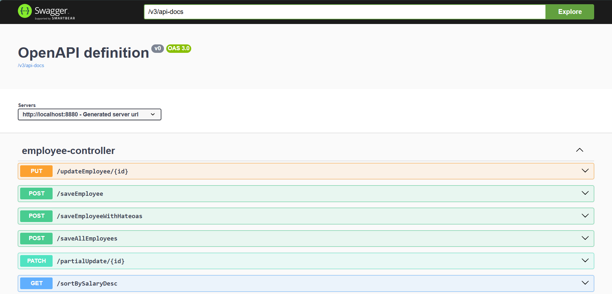
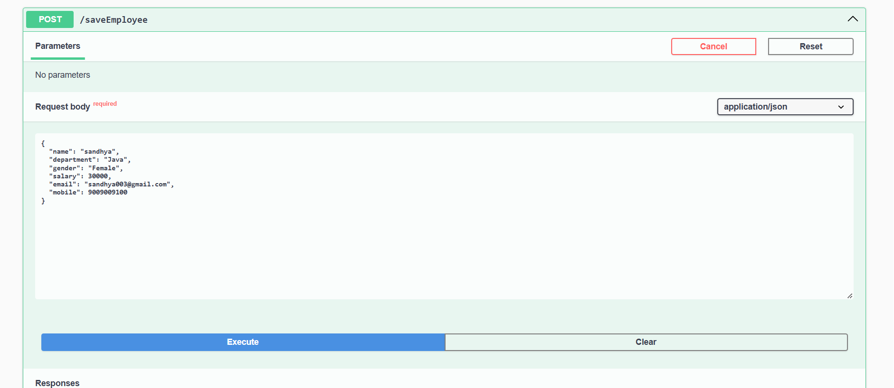
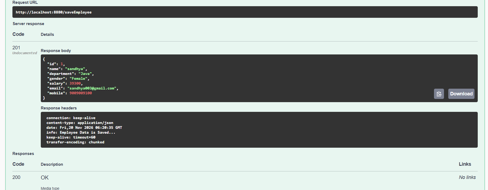
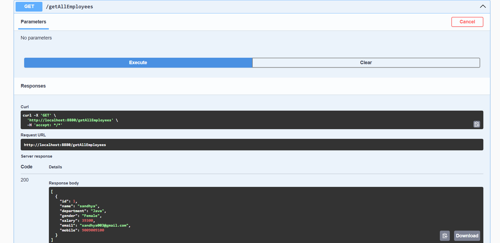
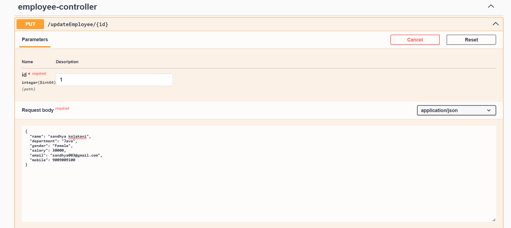
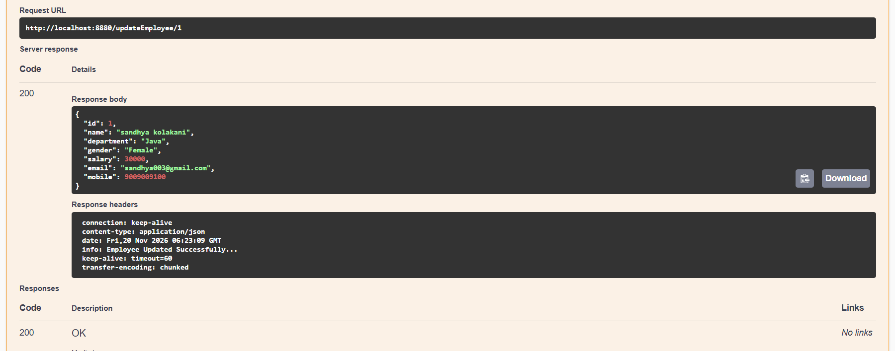
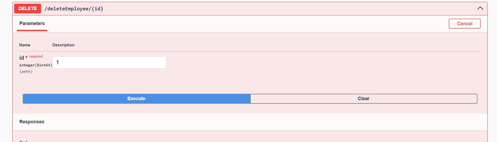
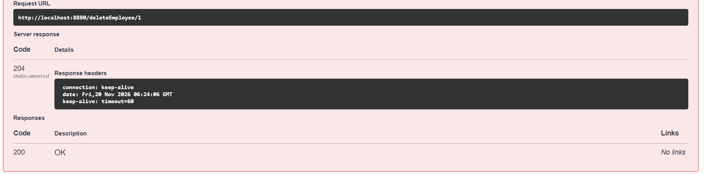

# Employee Records Management System

## Project Overview
The Employee Records Management System is a backend web application developed using Java and Spring Boot. It provides RESTful APIs to manage employee information efficiently through CRUD (Create, Read, Update, Delete) operations.

The application uses Swagger UI for API documentation and testing, making it easier to interact with and verify the available endpoints.

## Technologies Used
- Java
- Spring Boot
- Spring REST APIs
- Maven
- Swagger UI
- Git and GitHub

## Key Features
- Create new employee records.
- Retrieve employee details.
- Update existing employee information.
- Delete employee records using employee ID.
- Test and explore REST APIs through Swagger UI.

## CRUD Operations
| Operation | Description |
|---|---|
| POST | Create a new employee |
| GET | Retrieve employee records |
| PUT | Update employee details |
| PATCH | Partially Update employee details |
| DELETE | Delete an employee by ID |

## Project Screenshots

### 1. Employee Records Management

### 2. Create Employee

### 3. Employee Created Successfully

### 4. Get Employee Records

### 5. Update Employee

### 6. Employee Updated Successfully

### 7. Delete Employee by ID

### 8. Employee Deleted Successfully

## How to Run the Project

1. Clone this repository.
2. Import the project into Spring Tool Suite (STS) as an Existing Maven Project.
3. Wait for Maven dependencies to download.
4. Run the Spring Boot application.
5. Open the Swagger UI in your browser:

   http://localhost:8880/swagger-ui/index.html

## Author
**Sandhya Kolakani**

[GitHub](https://github.com/SandhyaKolakani)
